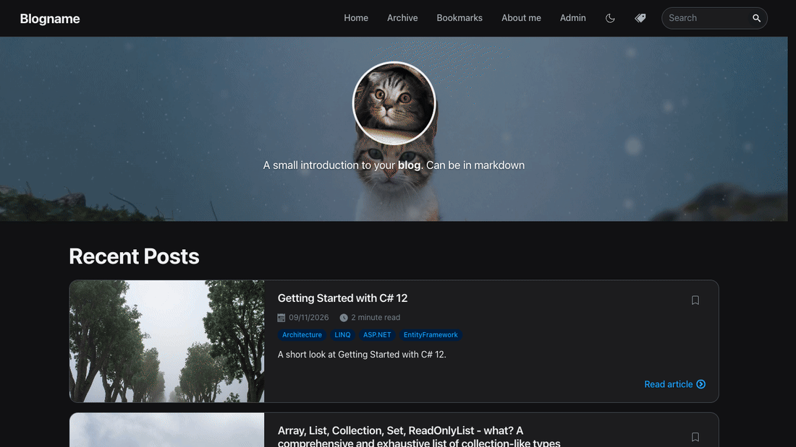

# LinkDotNet.Blog

A blog engine written completely in C# / Blazor, built to be as configurable as possible.

Authors write posts in markdown, which is rendered to HTML (including syntax-highlighted code snippets) for readers.

## Where to start

- [Setup](Setup/Readme.md) - get the blog running locally or from a release
- [Configuration](Setup/Configuration.md) - all `appsettings.json` options
- [Docker](Setup/Docker.md) - host the blog in containers
- [Upgrading from an older version](Migrations/Readme.md) - breaking changes and the Upgrade Assistant

## Guides

- [Storage Provider](Storage/Readme.md)
- [Authorization](Authorization/Readme.md)
- [Comments](Comments/Readme.md)
- [Media Upload](Media/Readme.md)
- [Search Engine Optimization (SEO)](SEO/Readme.md)
- [Donations](Donations/Readme.md)
- [Advanced Features](Features/AdvancedFeatures.md) including [bookmarks, drafts, and scheduled publishing](Features/AdvancedFeatures.md#bookmarks-drafts-and-scheduled-publishing)
- [Styling](Features/Styling.md)

## Links

- [Source code](https://github.com/linkdotnet/Blog)
- [Releases](https://github.com/linkdotnet/Blog/releases)
- [Migration guide](../MIGRATION.md)
